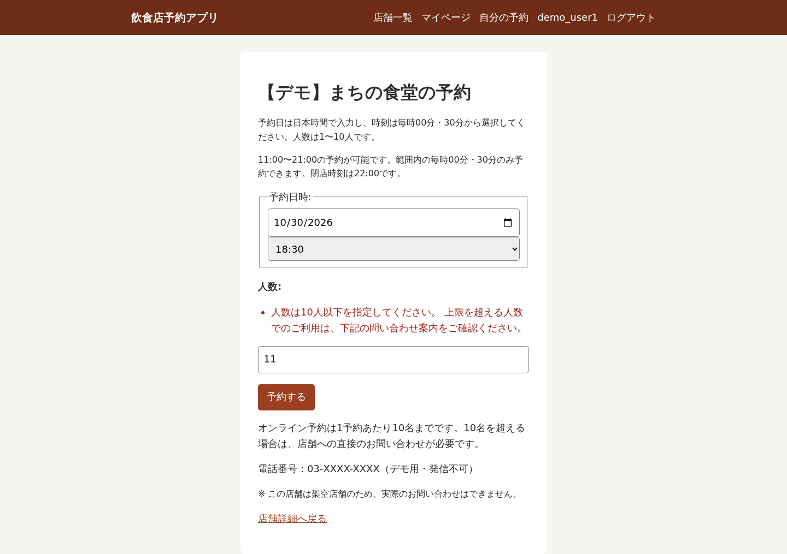
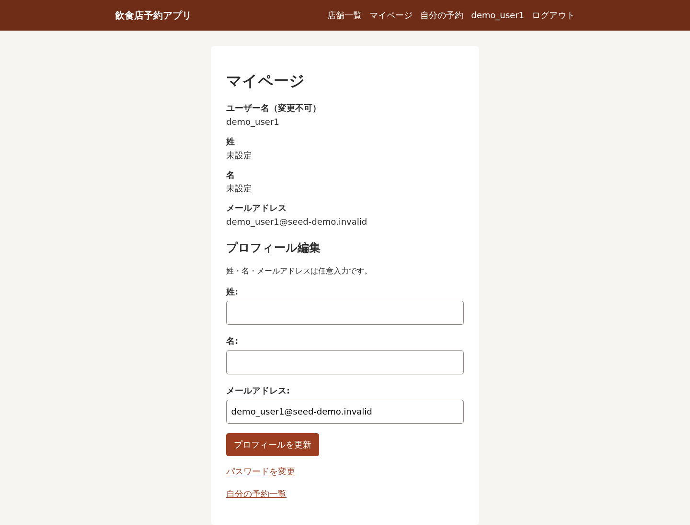
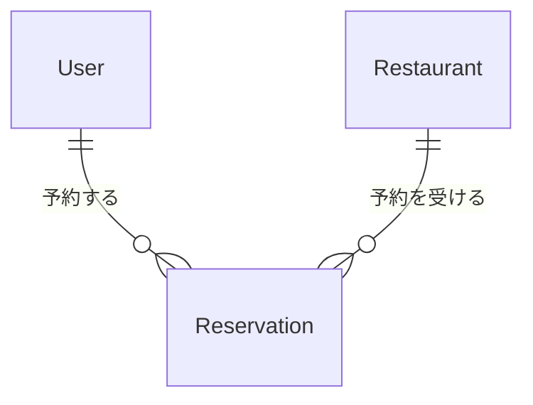

# 飲食店予約Webアプリ

## 概要

DjangoとMySQLで構築した飲食店予約アプリです。
店舗情報を閲覧し、会員登録・ログイン後に予約の作成やキャンセルができます。
HTML画面と予約JSON APIを提供します。

## 開発目的

PythonによるWeb開発を学ぶために作成しました。
Djangoの認証・ORM・フォーム・テンプレート・管理画面と、DRFによるAPIを使い、
入力検証、本人限定の操作、予約履歴の保持を実装しています。

## 主な機能

- 店舗一覧・詳細の閲覧（ログイン不要）
- 会員登録・ログイン・ログアウト
- マイページで本人の情報確認・姓／名／メールアドレスの編集・パスワード変更
- 店舗別の予約可能時間・最大人数に応じた予約作成（日本時間、予約時刻は毎時00分・30分の30分刻みで選択）
- 自分の予約一覧と、開始前の予約済み予約のキャンセル
- 過去・キャンセル済みの予約履歴の保持
- 予約JSON API（一覧・作成・論理キャンセル）
- 店舗詳細・予約画面の電話問い合わせ案内（店舗別のオンライン予約上限を超える場合）
- Django管理画面による店舗管理・任意の電話番号設定

## スクリーンショット

撮影専用の独立環境で、初期デモデータと`demo_user1`を使用して撮影した最新画面です。画面幅は1440pxで統一しています。
初期デモ店舗の電話番号は未登録のため、問い合わせ案内と未登録表示を掲載しています。電話番号設定時の表示・`tel:`リンクの確認方法は[動作確認](#動作確認)を参照してください。

デモ店舗の写真は架空店舗のイメージ画像です。写真は静的ファイルとして同梱し、通常店舗は「画像なし」を表示します。
[写真の出典・ライセンス](docs/image-credits.md)を参照してください。画像アップロード機能はありません。

### 店舗一覧

予約可能なデモ店舗2件と、マイページ・自分の予約へのリンクを含む最新ヘッダーです。


### 店舗詳細

営業時間・最終予約可能時刻・最大予約人数10人と、人数超過時の問い合わせ案内を表示しています。電話番号は未登録で、電話リンクはありません。


### 予約作成

日付入力と30分刻みの時刻selectを使用するフォームです。18:30を選択し、毎時00分・30分の案内と電話番号未登録の表示を確認できます。


### 人数上限を超えた場合

上限10人の店舗に11人を入力した際の赤字エラーと問い合わせ案内です。電話番号は未登録です。この送信で予約が保存されないことも確認しています。



### マイページ・プロフィール編集

変更不可のユーザー名、姓・名の「未設定」表示、デモ専用メールアドレスと編集フォームです。パスワード変更・自分の予約一覧へのリンクも表示しています。



## マイページ

マイページでは姓・名・メールアドレスの編集とパスワード変更ができ、ユーザー名は変更できません。
不正入力は保存せず、パスワード変更後もログイン状態を維持します。
詳細は[設計書](docs/design.md#マイページパスワード変更)を参照してください。

## 技術スタック・選定理由

| 技術 | バージョン・用途 |
| --- | --- |
| Python | 3.13 |
| Django | 5.2系：Webアプリ・認証・ORM・管理画面 |
| Django REST Framework | 3.18系：予約JSON API |
| MySQL | 8.4：データ保存 |
| mysqlclient | DjangoからMySQLへの接続 |
| Docker / Docker Compose | ローカル開発環境 |

Python依存関係の範囲は`requirements.txt`に記載しています。

Djangoの標準機能で認証・フォーム・管理画面を揃え、MySQLで関連データの管理、DRFでJSON APIの開発を学ぶ構成です。
Docker ComposeでWebとDBの開発環境を再現できるようにしています。

## ER図



UserはDjango標準モデルです。各予約は1人のユーザーと1つの店舗に属し、ユーザーと店舗はそれぞれ複数の予約を持てます。
詳細なモデル定義は[設計書](docs/design.md#データ)を参照してください。

## 実装上の工夫

- **予約バリデーションの共通化**：HTMLフォームとJSON APIで、日時形式・未来日時・店舗別の予約可能時間・人数上限の検証関数を共有しています。
- **本人限定の操作**：予約一覧・キャンセル対象をログイン中のユーザーで絞り込み、他人の予約を閲覧・操作できないようにしています。
- **履歴の保持**：キャンセルは予約を削除せず、状態を更新します。過去・キャンセル済みの予約も履歴として残します。
- **安全なデモ投入**：ローカル専用の`seed_demo`は、再実行時の既存データ保持と識別情報の衝突時の停止により、上書きを防ぎます。

## セットアップ・デモアカウント

DockerとDocker Compose v2が必要です。以降のコマンドはリポジトリのルートで実行します。

```bash
git clone https://github.com/shimodum/restaurant-reservation-app.git
cd restaurant-reservation-app
cp .env.example .env
```

`.env`の`DJANGO_SECRET_KEY`、`MYSQL_PASSWORD`、`MYSQL_ROOT_PASSWORD`を任意の値に変更してください。
`.env`はGit管理対象外です。`MYSQL_HOST=db`はそのまま使用します。
この環境はローカル開発用です。

```bash
docker compose up -d --build
docker compose exec web python manage.py migrate
docker compose exec web python manage.py seed_demo
docker compose exec web python manage.py check --database default
```

http://localhost:8000/ を開きます。
`seed_demo`でデモ店舗2件とサンプル予約4件を投入します。空のDBから構築した場合、店舗一覧はこの2件です。既存店舗はそのまま残ります。
次の一般ユーザーでログインし、「自分の予約」で本人の予約済み・キャンセル済み予約を確認できます。

| ユーザー名 | パスワード |
| --- | --- |
| `demo_user1` | `demo1234` |
| `demo_user2` | `demo1234` |

初回投入時の翌日以降の19:00に予約を用意します。
もう一方のユーザーでログインすると、本人限定の一覧を確認できます。
デモユーザーには管理者権限がありません。

### 動作確認

1. セットアップ後に`seed_demo`を実行し、`demo_user1`でログインします。店舗一覧・詳細から予約画面へ進み、未来の日付と11:00〜21:00の30分刻みの時刻を選択してください。予約作成・自分の予約一覧への表示・開始前のキャンセルと履歴保持を確認します。
2. 「【デモ】まちの食堂」で未来の日付・有効な時刻・11人（上限10人）を送信し、人数エラーと問い合わせ案内が表示され、予約が保存されないことを確認します。
3. 初期デモでは電話番号が未登録です。店舗詳細・予約画面に未登録の案内が表示され、電話リンクがないことを確認します。
4. マイページの確認には別の確認用ユーザーを登録してログインし、姓・名・メールアドレスを編集します。空欄時の「未設定」表示と不正メールの保存拒否も確認してください。「パスワードを変更」で変更後のログイン維持と、ログアウト後の新しいパスワードでの再ログインを確認します。
5. 電話番号付きの問い合わせリンクを確認する場合は、`docker compose exec web python manage.py createsuperuser`で管理者アカウントを作成し、`/admin/`の店舗編集画面からデモ店舗に自分で管理する電話番号を設定してください。第三者の番号や未確認のダミー番号は使用しないでください。一般ユーザーで店舗詳細・予約画面の番号表示を確認し、開発者ツールでリンクの`href`が`tel:`＋ハイフンを除いた番号になっていることを確認します。実際の発信は不要です。

デモ用管理者は用意していません。プロフィール・パスワードの確認には、デモユーザーの初期情報を保持できる別ユーザーを推奨します。
店舗追加も確認する場合は、管理画面から店舗を追加し、開店・最終予約可能・閉店時刻と最大予約人数を設定して、店舗一覧への表示と予約作成を確認します（任意）。

`seed_demo`は`DEBUG=True`かつ`ALLOWED_HOSTS`が`localhost`・`127.0.0.1`のみの環境専用です。
再実行しても追加・更新・削除は行わず、予約日時や操作後の状態も保持します。
識別情報の衝突・欠落時は停止します。デモユーザーの専用メールを変更した場合も、再実行時に安全停止する可能性があります。既存データを上書きする動作ではなく、DBの初期化は不要です。
過去になった予約日時は更新しないため、新しい予約は画面から作成してください。
識別方法の詳細は[設計書](docs/design.md#デモデータ投入)を参照してください。

店舗の開店・最終予約可能・閉店時刻は日本時間・分単位で、
`開店時刻 < 最終予約可能時刻 < 閉店時刻`となるよう設定します。
例：開店11:00、最終予約21:00、閉店22:00、最大予約人数20。
3時刻をすべて空欄にすると新規予約の受付を停止します。一部だけの設定はできません。
営業時間の補足案内に記載するL.O.は、予約可能時刻の自動判定には使用しません。

電話番号は管理画面から任意登録できます（国内番号・半角数字10〜11桁、ハイフン任意）。
電話だけでは予約は確定せず、受付可否・予約手続きは店舗への確認が必要です。
`seed_demo`再実行でも管理者が設定した番号を保持します。
番号の検証ルールは[店舗設定](docs/design.md#restaurantの予約設定)、問い合わせ表示の詳細は[画面仕様](docs/design.md#フォームview画面)を参照してください。

既存環境の更新時もビルドと`migrate`を実行してください。

通常の起動・停止：

```bash
docker compose up -d
docker compose down
```

DBデータは`mysql_data`ボリュームに保持されます。`docker compose down -v`はDBデータも削除します。
初回作成後に`.env`のMySQLパスワードを変更しても、既存DBの認証情報は変わりません。

## 主要URL

ベースURL： http://localhost:8000

| 画面・操作 | パス | 条件 |
| --- | --- | --- |
| ホーム | `/` | ログイン不要 |
| 店舗一覧 | `/restaurants/` | ログイン不要 |
| 店舗詳細 | `/restaurants/<id>/` | ログイン不要 |
| 会員登録 | `/accounts/signup/` | ユーザー名・パスワードを登録 |
| ログイン | `/accounts/login/` | 登録済みの会員 |
| マイページ・プロフィール更新 | `/accounts/mypage/` | GET／POST・ログイン必須・本人のみ |
| パスワード変更 | `/accounts/password/change/` | GET／POST・ログイン必須・本人のみ |
| 予約作成 | `/restaurants/<id>/reserve/` | ログイン必須 |
| 自分の予約 | `/reservations/` | ログイン必須 |
| 予約キャンセル | `/reservations/<id>/cancel/` | POST・本人のみ |
| ログアウト | `/accounts/logout/` | POST |
| 管理画面 | `/admin/` | 管理者権限 |

`<id>`は店舗または予約のIDです。画面のPOST操作はボタンから行います。

## API仕様

既存の `/accounts/login/` でログインしたセッションCookieを使用します。
POST・DELETEには、セッションCookieに加えて`X-CSRFToken`ヘッダーが必要です。
POSTの`Content-Type`は`application/json`を指定します。
JWT・Token・Basic認証、API専用ログイン、Browsable APIは提供しません。

| メソッド | パス | 成功時 |
| --- | --- | --- |
| GET | `/api/reservations/` | 200：本人の全予約履歴の配列（空なら`[]`） |
| POST | `/api/reservations/` | 201：作成した予約 |
| DELETE | `/api/reservations/<id>/` | 204：本文なし、状態を`cancelled`へ更新 |

一覧・キャンセルは本人の予約だけが対象です。DELETEは履歴を残す論理キャンセルで、開始前の予約済み予約に限ります。

作成時は店舗ID（`restaurant`、JSON整数）、日本時間の未来日時（`reserved_at`、`YYYY-MM-DDTHH:MM`）、人数（`party_size`、整数）を指定します。
時刻は店舗の受付範囲内の毎時00分・30分、人数は1〜店舗の最大予約人数です。

リクエスト例（店舗ID・日時は利用時の条件に合わせて変更）：

```json
{
  "restaurant": 1,
  "reserved_at": "2030-01-11T19:00",
  "party_size": 2
}
```

出力項目・応答例は[設計書](docs/design.md#apiの入出力詳細)、エラー時のHTTPステータスと条件は[主なエラー](docs/design.md#主なエラー)を参照してください。

## テスト

### 初回のテストDB権限設定

自動テストは開発DBとは別の`test_restaurant_reservation`を作成し、終了後に削除します。
`.env.example`と同じDB名・ユーザー名を使用する場合、初回に以下の権限を追加してください。
変更している場合は設定に合わせて読み替えます。開発DBをテストDBに指定しないでください。

```bash
docker compose exec db mysql -u root -p
```

初回構築時の`MYSQL_ROOT_PASSWORD`を入力し、MySQLで次を実行します。

```sql
GRANT ALL PRIVILEGES ON `test\_restaurant\_reservation`.* TO 'restaurant'@'%';
SHOW GRANTS FOR 'restaurant'@'%';
exit
```

`\_`はDB名の`_`を文字として扱う指定です。権限はテストDBに限定し、通常は初回だけ設定します。

### 実行コマンド

```bash
docker compose exec web python manage.py test
docker compose exec web python manage.py check
docker compose exec web python manage.py check --database default
docker compose exec web python manage.py makemigrations --check --dry-run
```

認証・本人限定操作、予約の日時・人数と電話案内、プロフィール・パスワード変更を検証します。
API・CSRF・履歴保持・Migration・デモ投入の回帰テストも含みます。詳細は[設計書のテスト](docs/design.md#テスト)を参照してください。
デモ投入コマンドのテストのみ実行する場合は`docker compose exec web python manage.py test reservations.tests_seed_demo`を使用します。
APIのみ実行する場合は`docker compose exec web python manage.py test reservations.tests_api`を使用します。

### 動作確認結果

実装`efb8c17`の既存検証記録では、Docker/MySQLの独立したテストDBで全117件の自動テストが成功しています。
`python manage.py check`は問題なし、`makemigrations --check --dry-run`は差分なしでした。
PC（1440px程度）・スマートフォン（375px・320px）で主要画面と予約・認証・マイページ・電話問い合わせ案内を確認済みです。
実際の電話発信、管理画面のレスポンシブ表示、全画面での表示崩れ・想定外エラーの網羅的確認は未完了です。
今回のREADME整理では、自動テスト・システムチェック・Migration差分確認を再実行していません。

## 設計書・対象外機能

モデル・ER図・予約ルール・実装構成は[設計書](docs/design.md)を参照してください。

### 今後検討している追加機能

以下はすべて未実装で、今後の追加を検討している機能です。

- 定休日・臨時休業の管理
- 店舗画像の登録・表示（店舗ごとの画像登録機能。現在のデモ用静的画像表示とは別）
- 店舗検索
- 予約枠・定員管理（現在の1予約あたりの最大人数設定とは別）
- 予約確認メール

### 現バージョンでは対象外の機能

上記の追加検討機能に加え、以下も未実装です。

- 曜日別営業時間・日をまたぐ営業時間・営業時間帯の分割・滞在時間
- 重複予約の判定
- ページネーション・レビュー・お気に入り
- 決済・予約確認以外のメール通知・店舗オーナー機能・管理画面での予約管理
- JavaScriptによる非同期処理・本格的なデザイン変更・ファビコン・デプロイ

予約情報を登録するMVPであり、実店舗の空席を保証する仕組みは提供していません。
